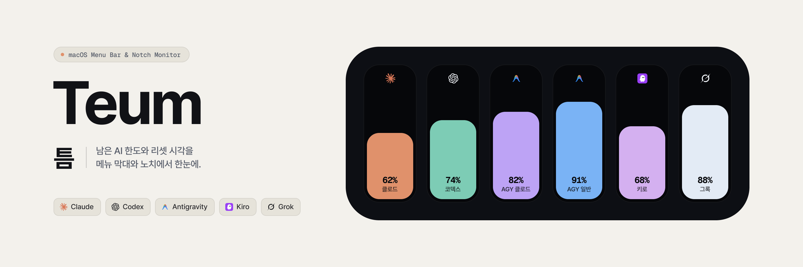
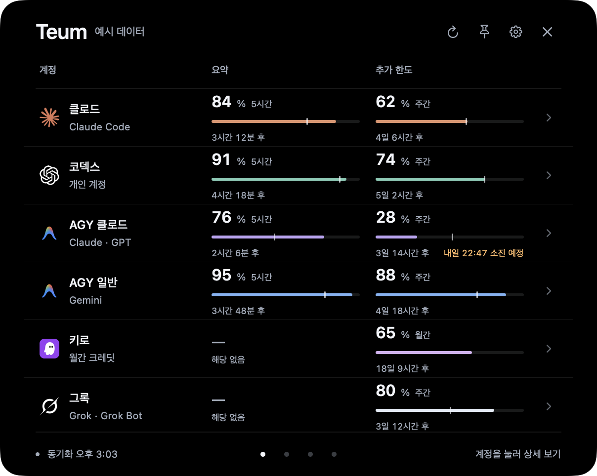
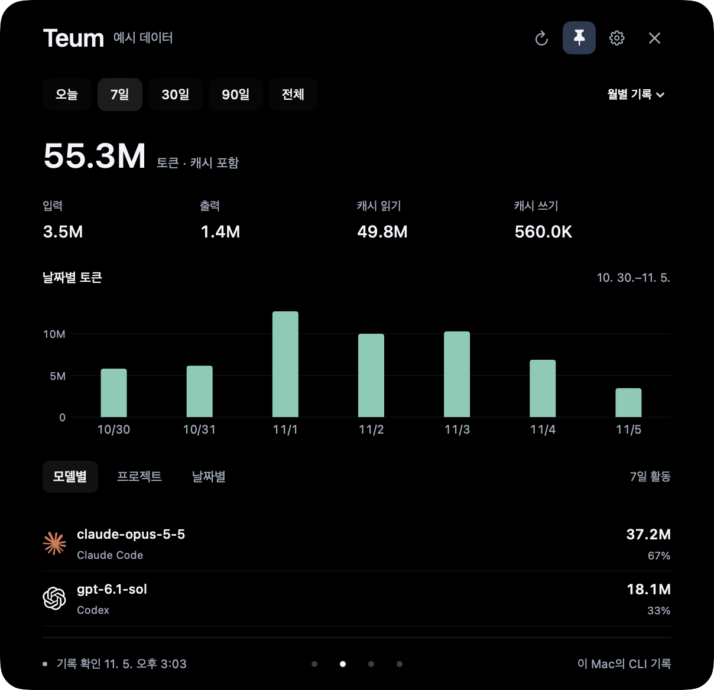
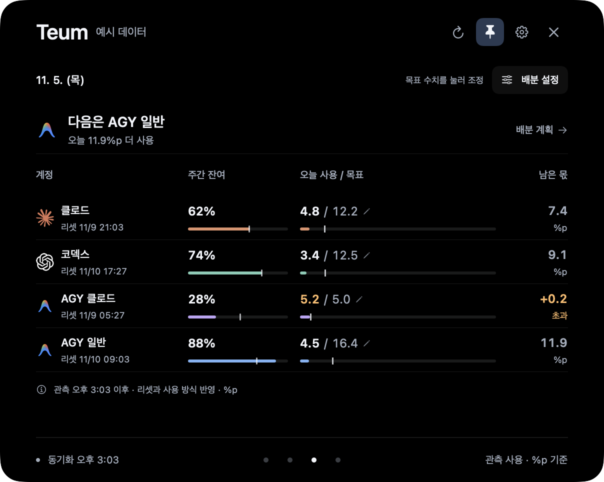
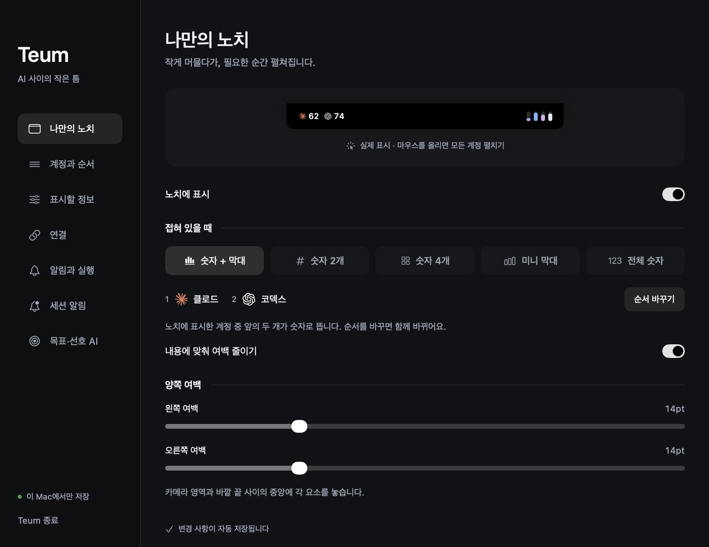

<p align="center">
  
</p>

# 남은 AI 한도, 한눈에.
Claude Code·Codex·Antigravity·Kiro·Grok의 남은 한도와 리셋 시각을 메뉴 막대와 노치에서 확인하는 macOS 앱입니다. 처음 실행하면 노치가 ‘숫자+막대’로 표시됩니다.

<p>
  <a href="https://github.com/leeyekrj/teum/releases/latest"></a>
  
  
  <a href="LICENSE"></a>
</p>

**[다운로드](https://github.com/leeyekrj/teum/releases/latest)** · [화면 둘러보기](#화면-둘러보기) · [여러 계정 연결](#여러-계정-연결) · [CLI 사용법](cli/README.md) · [문제 제보](https://github.com/leeyekrj/teum/issues)

<p align="center">
  
</p>

> 아래 앱 화면은 배포본을 예시 데이터로 렌더한 이미지입니다. 상단 막대 이미지는 소개용 그래픽입니다.

## 설치
macOS 14 이상, Apple Silicon·Intel Mac을 지원합니다. 터미널에서 다음 한 줄을 실행하세요. 빌드 도구는 필요 없습니다.
```bash
curl -fsSL https://raw.githubusercontent.com/leeyekrj/teum/main/install.sh | bash
```
GitHub Release에서 앱을 받아 SHA256과 서명 무결성을 확인한 뒤 `/Applications/Teum.app`에 설치합니다. 해당 폴더에 쓰기 권한이 없으면 `~/Applications/Teum.app`을 사용합니다. `~/.local/bin/teum-cli`도 설치하며 CLI 실행에는 **Python 3.9 이상**이 필요합니다. AI 도구의 훅·설정은 자동 변경하지 않습니다.

현재 배포본은 ad-hoc 서명이며 **Apple 공증을 받지 않았습니다**. 최초 실행이 차단되면 앱을 한 번 연 뒤 **시스템 설정 → 개인정보 보호 및 보안 → 그래도 열기**를 확인하세요. Gatekeeper를 끄거나 격리 속성을 지우는 명령은 사용하지 않습니다. 관리 기기에서는 조직 정책에 따라 허용되지 않을 수 있습니다.

설치 스크립트를 먼저 읽고 실행하려면:
```bash
curl -fsSL https://raw.githubusercontent.com/leeyekrj/teum/main/install.sh -o /tmp/teum-install.sh
less /tmp/teum-install.sh
bash /tmp/teum-install.sh
```
직접 다운로드: [최신 릴리스](https://github.com/leeyekrj/teum/releases/latest). ZIP을 풀고 Teum.app을 응용 프로그램 폴더로 옮기면 됩니다.

## 화면 둘러보기
### 리셋을 기다릴지, 다른 AI를 쓸지
메뉴 막대에는 설정 순서의 첫 번째 표시 계정이 흑백 원형 안의 숫자로 나타납니다. 아이콘에 마우스를 올리면 바로 아래에 계정 목록이 열립니다. 클릭으로 열고 닫을 수 있으며, 패널은 노치와 같은 검정 배경으로 부드럽게 나타나고 사라집니다. 노치를 꺼도 같은 패널을 사용할 수 있습니다. 단기·주간 한도를 나란히 보고, 계정을 누르면 정확한 리셋 시각을 확인합니다. 연결된 Codex 프로필도 각각 구분합니다.

### 이번 주에 얼마나 썼는지
로컬 Claude Code·Codex·OpenCode 기록을 날짜·모델·프로젝트별로 살펴봅니다. 입력·출력·캐시를 구분하며, 토큰 기록과 구독 한도는 별개의 수치로 표시합니다.

<p align="center">
  
</p>

### 남은 한도를 오늘의 목표로
오늘 쓸 몫을 정하고 관측한 사용량과 비교합니다. 배분 계획에서는 다음 리셋까지 계정별로 얼마나 쓸 수 있을지 살펴봅니다. 미래 리셋 뒤의 사용량은 예상으로 구분합니다.

<p align="center">
  
</p>

### 내 작업에 맞는 노치
작게 숫자만 띄우거나 미니 막대로 보고, 필요할 때 펼칩니다. 표시할 계정·순서·색·여백·리셋 시각과 경고 기준을 직접 고릅니다. 알림은 리셋·부족·소진과 세션별 조건을 설정할 수 있습니다.

<p align="center">
  
</p>

서비스의 비공식 사용량 API와 로컬 CLI 형식은 변경될 수 있습니다. 조회 실패 시 마지막 값을 보존하고 오래된 상태임을 표시합니다. 리셋 시각만으로 100%를 만들어내지 않습니다.

## 여러 계정 연결
- **Codex 다중 계정(프로필 추가)**: 기본 `~/.codex` 외에 업무·팀·학교 등 여러 Codex 계정을 쓰려면 터미널에서 프로필별 홈 폴더(`~/.codex-<이름>`)로 로그인한 뒤 앱에서 불러오면 됩니다.
  ```bash
  CODEX_HOME=~/.codex-work codex login
  ```
  로그인이 끝나면 **Teum 설정 → 연결 → `프로필 찾기`** 버튼을 누르세요(앱을 다시 시작해도 자동 감지합니다). 추가된 프로필은 **설정 → 계정과 순서**에서 원하는 이름(예: `코덱스 회사`, `코덱스 서브`)과 색상으로 바꿀 수 있습니다.
- **Antigravity (AGY)**: 하나의 앱 로그인에서 `AGY 클로드(Claude · GPT)`와 `AGY 일반(Gemini)` 두 모델 그룹의 한도를 자동으로 분리해 보여줍니다.
- **Claude Code · Kiro · Grok**: 현재 각 CLI·앱에 로그인된 활성 계정을 연결합니다. 계정을 전환하려면 **설정 → 연결**에서 `다시 로그인`(또는 앱 열기) 후 `모두 다시 확인`을 누르면 됩니다.

## CLI
`~/.local/bin`이 PATH에 있어야 합니다. PATH에 없다면 아래 명령에서 `teum-cli` 대신 `~/.local/bin/teum-cli`를 쓰세요.
```bash
teum-cli status --json
teum-cli refresh
teum-cli budget --host codex --json
teum-cli plan --json
teum-cli doctor
```
기존 세션에 주는 훅은 권고 문맥입니다. `teum-cli run`으로 시작한 단발 작업에만 실행 대기·모델 선택·소진 시 중단이 적용됩니다. [CLI와 선택적 AI 훅 설치](cli/README.md)를 참고하세요.

## 업데이트와 제거
Teum을 메뉴에서 종료한 뒤 설치 명령을 다시 실행하면 됩니다. 기존 앱은 같은 폴더에 백업하며, 설정·사용 기록·로그인은 유지합니다. 현재 앱에는 자동 업데이트가 없습니다. 다른 방식으로 설치한 `teum-cli`가 있으면 덮어쓰지 않으며 `bash /tmp/teum-install.sh --skip-cli`로 앱만 설치할 수 있습니다.

제거하려면 앱을 종료하고 Teum.app과 `~/.local/bin/teum-cli`를 삭제하세요. 별도로 설치한 AI 훅은 소스 폴더에서 `python3 cli/install.py --uninstall`로 제거합니다. 설정·기록까지 지우려는 경우에만 `~/Library/Application Support/Teum/`을 삭제하세요.

## 데이터와 권한
설정과 집계는 `~/Library/Application Support/Teum/`에 저장합니다. 기존 서비스의 로컬 인증 정보·키체인을 사용해 서비스에 사용량을 조회하며, Teum 자체 분석 서버로 보내지 않습니다. Kiro는 기존 세션의 접근 토큰을 갱신할 수 있습니다. Grok 연결에는 키체인 허용이 필요할 수 있습니다. 인증 토큰을 Teum 설정 폴더나 공개 배포본에 복사하지 않습니다.

이 저장소와 배포본에는 개발자의 개인 설정·계정·사용 기록·대화·개발 캡처가 포함되지 않습니다. 공급자 로고의 권리는 각 소유자에게 있습니다.

## 소스 빌드
Swift 6 이상이 포함된 Xcode Command Line Tools와 macOS 14 이상이 필요합니다.
```bash
git clone https://github.com/leeyekrj/teum.git
cd teum
zsh build.sh
build/Teum.app/Contents/MacOS/Teum --self-test
python3 -m unittest discover -s cli/tests
```
Universal 릴리스 제작: `python3 scripts/package-release.py --version 1.0.5`. 두 아키텍처를 빌드하므로 시간이 더 걸립니다. 패키지는 `dist/`에 생성됩니다.

## 라이선스
Teum은 [MIT License](LICENSE)로 배포합니다. 사용량 수집기와 모델 일부는 QuotaBar의 MIT 소스에서 가져왔습니다. QuotaBar·OpenUsage·CodexBar·codex-island·theSVG의 [출처와 라이선스 고지](THIRD_PARTY_NOTICES.md)를 소스와 앱 배포본에 포함합니다. Teum은 공급자들의 공식·제휴·후원 앱이 아닙니다.
